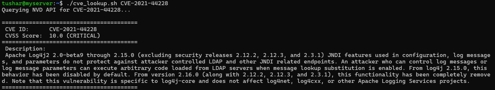

# CVE Lookup

## Overview
A simple Bash script that queries the National Vulnerability Database (NVD) API v2 to retrieve basic information about a specific vulnerability directly from the command line. 

Instead of navigating the NVD website manually, this tool uses `curl` to fetch the data and `jq` to parse the JSON response, outputting only the CVSS score, severity rating, and description.

## Features
- **REST API Interaction:** Uses `curl` to send HTTP GET requests to the NVD API and retrieve vulnerability information.
- **JSON Parsing:** Uses `jq` to extract the CVSS score, severity rating, and English description from the JSON response.
- **CVSS Fallback Logic:** Checks for CVSS v4.0, v3.1, v3.0, and v2.0 metrics in sequence, using the first available score and severity.
- **Single-Request Processing:** Stores the API response in a Bash variable and uses it for multiple JSON parsing operations without making additional API requests.

## Usage

**1. Make the script executable:**
```bash
chmod +x cve_lookup.sh
```

**2. Run the tool against a specific CVE:**
Pass a CVE identifier as the single argument.
```bash
./cve_lookup.sh CVE-2024-3094
```

**Example Output:**



## Limitations
* **Incomplete Error Handling:** Ignores HTTP response codes, failing to distinguish between a missing CVE (404), a rate limit block (403), or a server outage (503).
* **Schema Dependency:** Depends on NVD's current JSON schema; a structural change on their end would break the `jq` filters until updated.

## Future Improvements
* **API Key Support:** Add optional NVD API key support to increase the allowed request rate.
* **Bulk Processing:** Implement a loop to ingest a text file of CVEs and query them sequentially with appropriate throttling.

