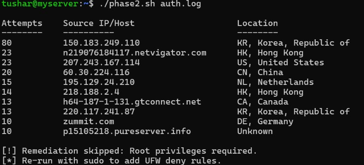
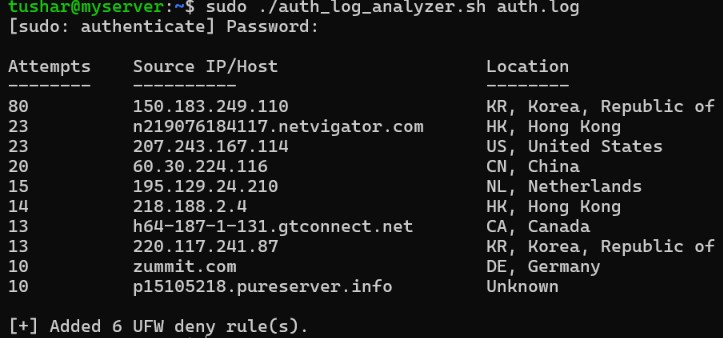

# Authentication Log Analysis

##  Overview
This script parses an `auth.log` file to identify the top source IPs responsible for brute-force login attempts, geolocates each IP using the local MaxMind GeoIP database for offline threat enrichment and optionally applies UFW blocking rules depending on operator privilege. 

##  Features
- **Log Parsing:** Extracts source IP addresses from authentication failure entries and ranks them by the number of occurrences.
- **GeoIP Enrichment:** Uses the local `geoiplookup` database to retrieve country information without relying on external APIs.
- **Privilege-Aware Remediation:** Checks execution privileges using `$EUID`. Root execution enables UFW rule creation, while non-root execution skips firewall modifications.
- **Report Generation:** Displays the top 10 source IP addresses, their authentication failure counts, and their corresponding GeoIP information.
- **Persistent Output:** Saves the extracted IP addresses and attempt counts to `Attacker_origin.txt` for further inspection.


##  Usage

### 1. Make the script executable:

`chmod +x auth_log_analyzer.sh`

### 2. Run in Audit/Report Mode (Non-Root):
Executing without `sudo` will parse the logs and generate the Threat Intelligence report, but will safely bypass the firewall modification loop.

`./auth_log_analyzer.sh /var/log/auth.log`

**Example Output**



### 3. Run in Remediation Mode (Root):
Executing with `sudo` will generate the report and immediately block the extracted malicious IPs across all ports using UFW.

`sudo ./auth_log_analyzer.sh /var/log/auth.log`

**Example Output**




---

##  Engineering & Refactoring Journey
Developing this script involved several iterations to improve execution flow, reduce code duplication, and separate reporting from firewall remediation.

### 1. Refactoring the Remediation Loop
The most significant architectural shift occurred in how the script handles automated blocking based on user privileges (`EUID`).

* **The Initial Mistake (Inefficient Evaluation):** Initially, the privilege check (`if [[ "$EUID" -eq 0 ]]`) was placed *inside* the main extraction loop. This meant the script was redundantly evaluating a static flag on every single iteration (for every IP address. Also the privilege check was placed inside the reporting loop. This mixed passive tasks (GeoIP lookups and displaying results) with active operations (firewall modification), making the execution flow less clear.
```bash
while read -r count ip; do
        country=$(geoiplookup "$ip" 2>/dev/null | awk -F': ' '{print $2}' || echo "Unknown")
        printf '%-10s  %-18s  %s\n' "$count" "$ip" "$country"
        if [[ "$BLOCKING_ENABLED" == true ]]; then
            ufw deny from "$ip" &>/dev/null
            (( ++BLOCKED )) || true
        fi
    done < "$OUTPUT_FILE"
```

* **The First Fix (Code Duplication):** To solve the efficiency issue, the condition was moved outside the loop. However, this created two massive `while` loops—one for root and one for non-root. This resulted in severe code duplication, with the Threat Intel (`geoiplookup`) and formatting (`printf`) logic written twice.
```bash
if [[ "$BLOCKING_ENABLED" == true ]]; then
    while read -r count ip; do
        country=$(geoiplookup "$ip" 2>/dev/null | awk -F': ' '{print $2}' || echo "Unknown")
        printf '%-10s  %-18s  %s\n' "$count" "$ip" "$country"
        ufw deny from "$ip" &>/dev/null
        echo "[+] Blocked $ip"
        (( BLOCKED++ )) || true
    done < "$OUTPUT_FILE"
else
    while read -r count ip; do
        country=$(geoiplookup "$ip" 2>/dev/null | awk -F': ' '{print $2}' || echo "Unknown")
        printf '%-10s  %-18s  %s\n' "$count" "$ip" "$country"
    done < "$OUTPUT_FILE"
fi
```
In both cases above, the `BLOCKING_ENABLED` variable is decided before by using the EUID.
* **The Final Architecture (Separation of Concerns):** The logic was decoupled entirely. The script now utilizes two distinct loops with single responsibilities:
  1. A **Reporting Loop** that always runs, handling geolocation and output.
  2. A **Remediation Loop** that only executes if `EUID == 0`, quietly reading from the temp file to apply UFW blocks. No duplication, no redundant evaluations.

### 2. Data Extraction (Parser Portability)

The script extracts attacker IP addresses from Linux authentication logs using the `rhost=` field present in the accompanying sample `auth.log`. This approach is simple, efficient, and accurately targets the log format used during development.

```bash
grep "authentication failure" "$LOG_FILE" \
| awk -F'rhost=' '{print $2}' \
| awk '{print $1}' \
| sort \
| uniq -c \
| sort -nr \
| head -n 10
```

This parser is designed for the provided sample log. Other Linux systems may record failed login attempts differently depending on their distribution and configuration.

#### Alternative Extraction Pipeline

For environments where failed SSH authentication events follow the common OpenSSH format (`Failed password ... from <IP>`), a more portable extraction pipeline can be used:

```bash
grep -E "Failed password|authentication failure" "$LOG_FILE" \
| grep -oE '\b([0-9]{1,3}\.){3}[0-9]{1,3}\b' \
| sort \
| uniq -c \
| sort -nr \
| head -n 10
```

This approach extracts IPv4 addresses directly using Extended Regular Expressions instead of relying on field positions such as `rhost=`. As a result, it is compatible with a wider range of common authentication log formats.

**Note:** In environments where reverse DNS resolution is enabled, some systems may record hostnames instead of IP addresses. Since this pipeline matches IPv4 addresses only, those entries would require a modified extraction pattern or disabling reverse DNS lookups (for example, by configuring `UseDNS no` where applicable).


---

##  Enterprise Architecture Limitations & Future Scope
While this script effectively demonstrates the core logic of log triage, deploying permanent, automated Bash scripts in a live production environment carries specific architectural risks:

1.  **Threshold-Based Detection vs. Absolute Ranking:** This script triages the absolute "Top 10" offenders for rapid incident response. However, automated enterprise blocking is governed by strict behavioral thresholds (e.g., ≥ 5 failed attempts within a 5-minute window) rather than arbitrary ranking. This prevents false positives, ensuring a legitimate user making a simple typo is not instantly banned.

2.  **Self-Denial of Service (Lack of Whitelisting):** Enterprise deployments typically maintain allowlists for trusted infrastructure such as administrative workstations, VPN gateways, monitoring systems, and internal management networks. Without whitelisting, repeated authentication failures from a legitimate administrator could result in an unintended self-denial of service.

3.  **Firewall Rule Bloat:** The script applies permanent UFW rules that remain until manually removed. In production, attackers frequently rotate source IP addresses, causing firewall rule sets to grow continuously and become difficult to manage. Enterprise intrusion prevention systems address this by applying temporary, automatically expiring bans instead of permanent firewall rules.

##  Future Improvements
In a production environment, the local firewall automation demonstrated by this project would typically be replaced by an intrusion prevention system such as **Fail2Ban**, which natively supports:

* Threshold-based detection
* Temporary (expiring) bans
* Trusted host and subnet whitelisting
* Automatic rule cleanup


