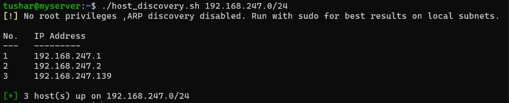
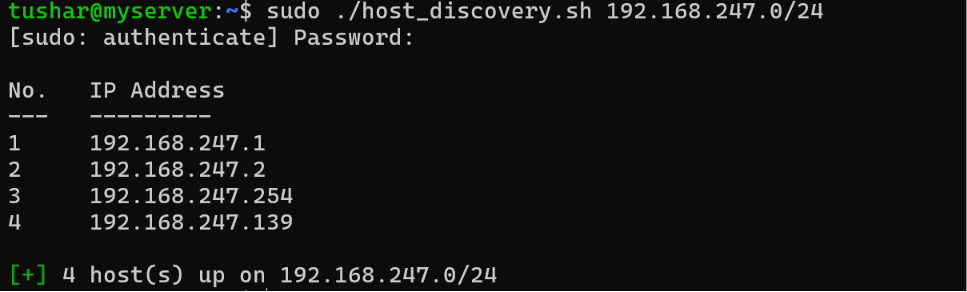

# Network Host Discovery Wrapper (Bash)

##  Overview
This script is a Bash wrapper for `nmap`, designed to perform rapid, reliable ping sweeps across a specified CIDR range. It is built with a heavy emphasis on strict input validation and clean, terminal-friendly output.

##  Features
* **Strict Input Validation:** Mathematically verifies IPv4 and CIDR notation before execution to prevent tool crashes or unintended network behavior.
* **Privilege Awareness:** Checks $EUID to enforce root-level ARP/multi-probe scanning for maximum host discovery, or warns the user when running in limited non-root TCP fallback mode.
* **Smart Output Formatting:** Utilizes `printf` for clean, tabular data presentation and ANSI color codes for logging (which automatically disable if output is piped to a file).
* **Fail-Fast Design:** Verifies all dependencies (like `nmap`) before attempting to run.

##  Usage

### Make the script executable:
```bash
chmod +x host_discovery.sh
```

Run the script against a target subnet:

### Unprivileged Execution (TCP fallback)
```bash
./host_discovery.sh 192.168.1.0/24
```
**Example Output**



### Privileged Execution (ARP discovery on local networks)
```bash
sudo ./host_discovery.sh 192.168.1.0/24
```
**Example Output**



---

## Engineering Decisions & Edge Cases
### 1. The Danger of Silent Failures
* **The Mistake:** Initially, I relied on a simple structural Regular Expression to validate the IP, assuming `nmap` would handle mathematically impossible IPs (like `999.999.999.999/24`). 
* **The Result:** The script created a dangerous "false negative." If a user typed a bad IP, `nmap` would fail silently, and the script would output `[!] No live hosts found`, misleading the operator into thinking the subnet was empty rather than realizing the scan never ran.
* **The Fix:** I implemented strict mathematical validation in native Bash *before* the `nmap` command. The script now parses the IP address into individual octets and verifies they do not exceed `255`, ensuring bad data never reaches the scanning engine.

### 2. Privilege Awareness & Firewall Evasion
- **The Mistake:** Early versions ran standard ping sweeps (`-sn`) without checking if the user had root privileges, assuming `nmap` worked the same way for all users.
- **The Result:** Without root access, `nmap` cannot create raw sockets and falls back to basic TCP probes on ports 80 and 443. Host firewalls (like Windows Defender) silently block these probes, making live machines on the local network look offline.
- **The Fix:** Added an `$EUID` check before the scan runs. When run as `root`, `nmap` uses raw sockets to send Layer 2 ARP requests on local subnets (bypassing host firewalls because machines must answer ARP to talk on the LAN) and multi-probe checks on remote networks. If run without `root`, the script warns the user that the scan is running in a weaker TCP fallback mode.

